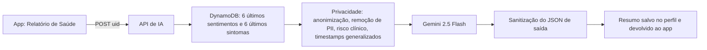

<p align="center">
  
</p>

# Candi, o Diário do Câncer ft. Rede Feminina de SCS

<p>
  
  
  
  
  
  
  
  
</p>

Este repositório contém o código-fonte do aplicativo mobile desenvolvido como produto principal na matéria de Projeto Integrador pelo grupo CANDI, na Fatec São Caetano do Sul (Antonio Russo), para os anos de 2025-2026, em parceria com a **Rede Feminina de Combate ao Câncer de São Caetano do Sul**. O CANDI tem como objetivo principal preencher o vazio relacionado à complexidade, ou falta, da documentação particular e diária sobre o câncer, além de incentivar uma maior participação da família e dos acompanhantes no tratamento oncológico.

O repositório é um **monorepo** e reúne as três partes do sistema: o **app mobile**, o **backend (API REST + WebSocket)** e a **API de IA** que gera o Relatório de Saúde. Todo o ambiente roda localmente com Docker.

## :busts_in_silhouette: O grupo CANDI é composto por:

<p align="center">
  
</p>

- **Carolina Pichelli Souza :violin: (dev front-end; designer; docs)**
- **Fernando Alcantara D´Ávila :video_game: (dev fullstack; cybersecurity)**
- **Guilherme Xavier Zanetti :drum: (scrum master; dev fullstack; ai admin; docs)**
- **Heloísa Pichelli Souza :tada: (analista de sistemas; dev front-end; UI/UX)**
- **Lucas Batista de Sousa :desktop_computer: (dev back-end)**
- **Nuno Kasuo Tronco Yokoji :long_drum: (DBA)**

**Parceiro:** Rede Feminina de Combate ao Câncer de São Caetano do Sul

## :trophy: Reconhecimentos

- **Conquista de dois segundos lugares na EXCUTE 2024 da ETEC Jorge Street (vice-campeão nas categorias popular e de habilitação)**

---

## :high_brightness: Propósito

Receber um diagnóstico de câncer significa, ao mesmo tempo, enfrentar o tratamento e administrar uma rotina intensa: consultas, exames, medicamentos com horários diferentes, sintomas que mudam de um dia para o outro. Quando isso fica espalhado em agendas de papel, mensagens de WhatsApp e na memória, o paciente perde o controle da própria jornada e a família, sem informação, tem dificuldade para ajudar.

O CANDI nasceu para reunir, em um único ambiente digital voltado exclusivamente ao contexto oncológico:

- **Organização prática**: agenda de compromissos, medicamentos com lembretes e marcos do tratamento;
- **Registro emocional e físico**: um diário privado, o registro de sentimentos (humor) e de sintomas;
- **Rede de apoio**: familiares e cuidadores convidados pelo próprio paciente, com permissões escolhidas por ele para acompanhar a rotina;
- **Acolhimento**: uma comunidade moderada, com grupos e chat, onde pacientes trocam experiências;
- **Insights**: um Relatório de Saúde gerado por IA a partir dos registros, escrito em tom acolhedor e com proteção de privacidade.

**Para quem é:**

| Perfil | Papel no app |
|---|---|
| **Paciente oncológico** | Usuário principal: registra, organiza e compartilha o que quiser da sua jornada. |
| **Rede de apoio** (familiares, amigos, cuidadores) | Acompanha, em modo somente leitura, as seções que o paciente liberou. |
| **Administrador** | Modera a comunidade e gerencia usuários e outros administradores. |
| **Rede Feminina de SCS** | Organização parceira que acolhe pacientes e dá o contexto institucional do projeto. |

### Diferencial frente às alternativas

| Alternativa | Limitação que o CANDI busca resolver |
|---|---|
| Agenda física/manual | Sem lembretes automáticos e sem compartilhamento com a rede de apoio. |
| Grupos de WhatsApp/Facebook | Pouco controle da informação, excesso de mensagens e ansiedade. |
| Apps genéricos de lembrete (ex.: Google Agenda) | Sem apoio emocional e sem integração com a rede de apoio. |
| Apps de saúde específicos | Não são pensados para o contexto emocional nem para a rede de apoio. |
| Acompanhamento presencial | Humanizado, mas limitado por tempo e sem registro contínuo entre as consultas. |

---

## :books: Contexto teórico

As decisões de produto do CANDI foram fundamentadas no **Documento de Visão do Projeto (v3.0, outubro/2025)**, elaborado pelo grupo em parceria com a Rede Feminina. Os principais pontos:

**Problema.** A falta de organização e de registro emocional durante o tratamento deixa o paciente sobrecarregado e desorientado. O impacto é a perda de controle sobre compromissos e medicamentos e a dificuldade de expressar sentimentos, o que gera sofrimento psicológico adicional.

**Oportunidade.** O Documento de Visão cita a estimativa do INCA de cerca de **600 mil novos casos de câncer por ano no Brasil** e a demanda crescente por humanização do cuidado em saúde, em especial na oncologia, onde o sofrimento psicológico acompanha o físico.

**Por que um diário.** A escrita como ferramenta terapêutica tem respaldo na literatura de saúde: os estudos de Pennebaker sobre *expressive writing* relacionam a escrita sobre experiências difíceis a benefícios para a saúde mental e física, e trabalhos em psico-oncologia discutem intervenções psicológicas no cuidado ao paciente com câncer. O diário privado, o registro de sentimentos e o de sintomas do CANDI partem dessa base (ver [Referências](#-referências)).

**Por que mobile.** A literatura sobre tecnologia móvel em saúde aponta ganhos em acompanhamento e adesão. A premissa do projeto é que lembretes e registros no celular, que o paciente já carrega, reduzem a carga de organizar o tratamento.

**Posicionamento.** *Para pacientes oncológicos que enfrentam dificuldades em organizar seus compromissos médicos e lidar com o impacto emocional do tratamento, o CANDI é um aplicativo de suporte pessoal que integra agenda com notificações, diário privado e comunidade de apoio em um único ambiente, voltado exclusivamente ao contexto oncológico.*

**Metas de qualidade definidas no Documento de Visão** (metas de projeto; ainda não validadas por testes de carga):

| Atributo | Meta |
|---|---|
| Desempenho | Requisições de API em até 2 s e telas carregando em até 1 s |
| Capacidade | Ao menos 500 usuários simultâneos |
| Disponibilidade | 99,5% ao mês |
| Privacidade | Conformidade com a LGPD (dados de saúde são dados sensíveis) |
| Acessibilidade | Diretrizes WCAG 2.1 |
| Plataformas | Android 9+ e iOS 13+ |

---

## :compass: Escopo e evolução em relação ao Documento de Visão

O Documento de Visão descreve dois produtos: o **aplicativo mobile** (este repositório) e o **sistema web** de atualização do site institucional da Rede Feminina (PHP/MySQL no servidor da própria organização, mantido à parte). **Este repositório contém o aplicativo mobile, o backend e a API de IA.** O [CANDI Sense](#-candi-sense-extensão-iot), uma extensão IoT do projeto, é descrito mais abaixo e também não faz parte deste código.

Durante o desenvolvimento, algumas decisões evoluíram em relação ao documento (a v3.0 é de outubro/2025):

| Tema | No Documento de Visão | Nesta versão |
|---|---|---|
| Contatos de confiança | Até 2 contatos, que também podem criar compromissos e medicamentos | **Rede de Apoio** por convite via e-mail, com **permissões escolhidas pelo paciente** (`agenda`, `diary_read`, `milestones`), vínculo N:N e acesso **somente leitura** |
| Acionamento rápido | Ligar para contatos de confiança | **Contatos de emergência** cadastrados pelo paciente, com acionamento por ligação |
| Notificações | Um dia antes e algumas horas antes | Lembretes locais: compromissos **1 hora antes**; medicamentos **diariamente no horário** cadastrado |
| Relatório personalizado por IA | Agente de IA tratando os dados do paciente | **Google Gemini 2.5 Flash**, com anonimização, sanitização de dados pessoais e detecção de risco clínico |
| Comunidade | Publicações, grupos, curtidas, comentários, convites de amizade | Feed, **grupos públicos e privados** (com aprovação), comentários, curtidas, favoritos, compartilhamento, denúncias e **chat 1-1 em tempo real** |
| Administração | Monitorar publicações e excluir as fora das diretrizes | **Painel de moderação** completo (denúncias, suspensão, banimento, gestão de admins) |
| Novidades | — | **Marcos do tratamento**, login com Google, recuperação de senha por código, modo de rede de apoio com painel próprio |
| Plataformas | Android e iOS | App Expo (Android/iOS/web); publicação nas lojas fica como próximo passo |

**Previsto no Documento de Visão e não implementado nesta versão:** visualização de notícias por tipo de câncer, recomendação de conteúdo pelo administrador, publicidade segmentada e fluxo de exclusão de conta.

---

## :satellite: CANDI Sense (extensão IoT)

O **CANDI Sense** é um projeto desenvolvido para a disciplina de **Sistemas Distribuídos Aplicados à Internet das Coisas**, usando o CANDI como contexto. A proposta é o **monitoramento doméstico passivo** de pacientes oncológicos: sensores em casa geram dados continuamente, sem exigir que o paciente registre nada, e complementam o que ele anota manualmente no app (diário, sentimentos e sintomas).

**Arquitetura definida** (nuvem AWS, distribuída em três instâncias EC2):

| Instância | Função |
|---|---|
| EC2 #1 | **Node-RED**: fluxos de integração |
| EC2 #2 | **Mosquitto**: broker MQTT que recebe as mensagens dos dispositivos |
| EC2 #3 | **InfluxDB + Grafana** (série temporal e dashboards) e um programa de **regras de negócio** que normaliza os dados recebidos |

Na borda, um **Arduino** montado com componentes de um kit RoboCore, com módulo Wi-Fi **ESP-01S**, publica as leituras em tópicos MQTT.

O CANDI Sense é um projeto acadêmico à parte: seu código não está neste repositório e ele ainda não está integrado ao app. Ele conversa com a linha de evolução prevista no Documento de Visão (integração com outros sistemas por meio de APIs).

---

## :bulb: Características Principais

### Paciente

- **Cadastro e acesso**: cadastro com nome, apelido, e-mail, data de nascimento e tipo de câncer; login por e-mail e senha ou pelo Google; recuperação de senha com código de 6 dígitos enviado por e-mail.
- **Diário**: passagens de texto livre organizadas por data, com leitura e edição.
- **Sentimentos e sintomas**: registro diário de humor (escala de 1 a 5, com observação) e de sintomas (lista de sintomas ou descrição livre).
- **Agenda**: compromissos em calendário com marcação por dia, e medicamentos com nome, dosagem, posologia, período e observação; lembretes por notificação no celular.
- **Marcos do tratamento**: checkpoints de progresso (criar, editar e marcar como concluído), visíveis também para a rede de apoio quando o paciente libera a permissão `milestones`.
- **Relatório de Saúde com IA**: análise de sentimentos e sintomas recentes, com recomendações práticas e alerta de saúde mental.
- **Contatos de emergência**: acionamento rápido por ligação.
- **Rede de apoio**: convidar familiares e cuidadores por e-mail, escolher o que cada um pode ver, acompanhar convites pendentes e revogar acessos.
- **Comunidade**: feed, grupos públicos e privados, posts com imagem, curtidas, comentários, favoritos, compartilhamento, denúncias e chat 1-1 em tempo real, com indicador de mensagens não lidas.
- **Perfil**: foto, dados pessoais, ajuda (FAQ), sobre o CANDI, termos de uso e política de privacidade.

### Rede de apoio (familiares e cuidadores)

- Conta criada a partir do **convite** do paciente (link com token de uso único, válido por 7 dias).
- Painel próprio, em **somente leitura**, que mostra apenas as seções liberadas (diário, agenda, marcos); as demais aparecem com cadeado.
- Um mesmo cuidador pode acompanhar **mais de um paciente**.

### Administrador

- Estatísticas gerais, fila de **denúncias** e de posts **suspensos** (aprovar ou remover), lista de **usuários banidos** (com opção de reverter) e **gestão de administradores** (somente o superadmin remove outros admins).

### Destaques técnicos

- **Monorepo** com três serviços e ambiente 100% local via Docker Compose (DynamoDB Local, S3 local, backend e IA).
- **Controle de acesso por papéis** (`patient`, `support`, `admin`) aplicado no backend (guards) e no app (redirecionamento por papel).
- **Modelo de dados em DynamoDB** com 18 tabelas e índices secundários, criadas automaticamente na inicialização.
- **Tempo real** com Socket.IO (mensagens, caixa de entrada, presença online, posts novos).
- **Moderação automática**: 3 denúncias suspendem um post; 3 posts removidos banem o autor.
- **Pipeline de IA com foco em privacidade** (detalhado em [Arquitetura](#-arquitetura-de-software)).
- **Migração do app para o Expo SDK 58** (React Native 0.88, React 19) e revisão de responsividade para telas de 320 a 430 px.

---

## 🛠️ Tecnologias Utilizadas:

| Camada | Tecnologias |
|---|---|
| **App mobile** | React Native 0.88, Expo SDK 58, Expo Router (rotas por arquivo), TypeScript, TanStack Query, React Native Paper, react-native-calendars, Reanimated, Socket.IO Client, AsyncStorage, expo-notifications, expo-image-picker, fontes Kadwa e Inter |
| **Backend** | NestJS 11 sobre Fastify, TypeScript, JWT (`@nestjs/jwt`), bcrypt, Socket.IO, Sharp (processamento de imagens), Nodemailer, class-validator, Jest |
| **Banco e arquivos** | Amazon DynamoDB (SDK v3) e Amazon S3; localmente, `amazon/dynamodb-local` e `luofuxiang/local-s3` |
| **IA** | Python 3.12, boto3, Google Gemini 2.5 Flash (`google-genai`); roda como AWS Lambda ou como container |
| **Infraestrutura** | Docker e Docker Compose; AWS (EC2, Lambda, DynamoDB, S3) na versão publicada |
| **Observabilidade** | Microsoft Clarity (versão web do app) |

---

## :gear: Arquitetura de Software

### Visão geral

```
            App (Expo: emulador Android / navegador)
        REST + Socket.IO │         relatório │          fotos │
                         ▼                   ▼                ▼
   ┌─────────── docker compose ─────────────────────────────────────┐
   │  backend :3000 ──► dynamodb :8000 ◄── ia-api :8001 ───────────┼──► Gemini (internet)
   │        └──────────────────────────────────────► s3 :8080       │
   └────────────────────────────────────────────────────────────────┘
```

| Parte | Versão publicada (AWS) | Execução local |
|---|---|---|
| Backend NestJS (REST + Socket.IO) | EC2 | container `candi-backend` (porta 3000) |
| Banco de dados (18 tabelas) | DynamoDB | container `amazon/dynamodb-local` (porta 8000) |
| Imagens e diários | Buckets S3 | container `luofuxiang/local-s3` (porta 8080) |
| API de IA | Lambda + Function URL | container `candi-ia-api` (porta 8001) |
| Gemini, e-mail (Gmail) e login Google | Internet | Internet (sem mudanças) |

### App mobile

- **Rotas por arquivo** (Expo Router). Um `AuthGate` na raiz verifica o token e o papel do usuário e redireciona para a área certa:

  | Papel | Área |
  |---|---|
  | `patient` | `/screens/(tabs)`: Comunidade, Agenda, Início, Diário e Perfil |
  | `support` | `/screens/support`: painel somente leitura |
  | `admin` | `/screens/admin`: painel de moderação |

- **Sessão**: `accessToken` e `refreshToken` em AsyncStorage, com renovação automática 60 s antes de expirar e *mutex* para impedir renovações simultâneas.
- **Contextos globais**: `ProfileContext` (perfil e papel), `ChatContext` (não lidas e atualizações) e `NotificationContext` (avisos dentro do app).
- **Design system**: paleta rosa `#FFC4C4`, menta `#CFFFE5` e azul `#759AAB`, fontes Kadwa (títulos) e Inter (texto), bordas bem arredondadas.

### Backend

Módulos NestJS: `Auth` (com `Recovery`), `Admin` (com `Support`), `Feed`, `Community`, `Chat`, `Diary`, `Journal` (sentimentos), `EmergencyContacts`, `ProfileImage` (S3) e `Schedule` (`Calendar`, `Medicines`, `Symptoms` e `Treatment/Milestones`), além do módulo de acesso ao DynamoDB.

**Autenticação e autorização**

- JWT com *access token* de 12 h e *refresh token* de 7 dias (segredos distintos); senhas com bcrypt (10 rounds).
- `AuthGuard` valida o token e bloqueia usuários banidos; `AdminGuard` exige o papel `admin`.
- Convite da rede de apoio: uso único, validade de 7 dias, permissões definidas pelo paciente.

**Tabelas do DynamoDB (18)**

| Domínio | Tabelas |
|---|---|
| Usuários e rede de apoio | `CANDIProfile`, `CANDIInvites`, `CANDISupportLinks` |
| Rotina de saúde | `CANDIAppointment`, `CANDIMedicines`, `CANDISymptoms`, `CANDIFeelings`, `CANDIEmergencyContacts`, `CANDITreatmentMilestones` |
| Comunidade | `CANDIPosts`, `CANDIGroups`, `CANDIGroupMembers`, `CANDIPostLikes`, `CANDIPostFavorites`, `CANDIComments`, `CANDIReports` |
| Chat | `CANDIMessages`, `CANDIUserConversations` |

Todas usam cobrança sob demanda (`PAY_PER_REQUEST`). O serviço de *bootstrap* cria as que ainda não existem ao iniciar.

**Tempo real (Socket.IO, namespace `/chat`)**: o cliente se autentica com o JWT no *handshake* e o servidor emite `new_message`, `inbox_update`, `messages_read`, `new_post`, `user_online`, `online_users` e `kicked_from_group`. O gateway guarda, por usuário, o conjunto de sockets ativos, o que permite vários dispositivos ao mesmo tempo.

**Arquivos (S3)**: fotos de perfil são convertidas para JPEG e imagens de grupos para WebP (via Sharp); cada passagem de diário é um arquivo de texto por data do usuário.

### API de IA (Relatório de Saúde)



Como o conteúdo é dado de saúde, a API trata os dados **antes** de enviá-los ao modelo:

1. **Anonimização do identificador**: o `profile_id` é substituído por um hash SHA-256 com *salt* (16 caracteres); o ID real nunca vai ao Gemini.
2. **Remoção de dados pessoais** em texto livre: CPF, telefone, e-mail e nomes próprios (por padrões de regex e tokenização, com lista de palavras seguras para evitar falsos positivos).
3. **Detecção de risco clínico**: termos como desmaio, falta de ar ou menções a autolesão são trocados por um marcador neutro e ativam um aviso que instrui o modelo a **não fazer diagnóstico**, apenas sugerir procurar atendimento de forma gentil.
4. **Generalização de datas e horários**: em vez do instante exato, o modelo recebe dia da semana, período do dia e semana do mês.
5. **Dado estatístico primeiro**: o modelo recebe um resumo (média de bem-estar, tendência, distribuição) como base e os registros individuais só como complemento.
6. **Sanitização da resposta**: a mesma limpeza de dados pessoais é aplicada ao JSON devolvido.

A resposta é um JSON estruturado com resumo empático, análise de sentimentos e de sintomas, recomendações, alerta de saúde mental (`nenhum`, `baixo`, `moderado` ou `alto`), encorajamento e próximos passos. O resultado é salvo no perfil (`lastSummary`).

A função aceita três modos: **verificação de saúde** (`GET /`), **sob demanda** (`POST /` com `uid`, usado pelo app) e **lote semanal** (`POST /` com `source: candi.weekly-scheduler`, para perfis com `isWeekly` ativo; na AWS era disparado pelo EventBridge).

> A remoção de dados pessoais é uma heurística (regex e tokenização) e não garante cobertura total. Está documentada como limitação conhecida.

---

## 📁 Estrutura do Projeto

```
CANDI/
├── mobile/                      # App React Native 0.88 + Expo SDK 58
│   ├── src/
│   │   ├── app/                 # Rotas (Expo Router)
│   │   │   ├── index.tsx        # Login
│   │   │   ├── cadastro.tsx, cadastroSupport.tsx
│   │   │   ├── recuperarSenha.tsx, redefinirSenha.tsx
│   │   │   └── screens/
│   │   │       ├── (tabs)/      # Home, Agenda, Diário, Comunidade e Perfil
│   │   │       ├── agenda/      # Compromissos, medicamentos, sintomas e relatório
│   │   │       ├── diary/       # Passagens e sentimentos
│   │   │       ├── community/   # Chat, grupos e detalhes de post
│   │   │       ├── profile/     # Convites, marcos, contatos, ajuda e sobre
│   │   │       ├── support/     # Painel da rede de apoio (somente leitura)
│   │   │       └── admin/       # Painel de moderação
│   │   ├── components/          # Componentes reutilizáveis
│   │   ├── context/             # Perfil, chat e notificações
│   │   ├── services/            # Chamadas à API, sockets e notificações
│   │   ├── constants/api.ts     # Endereços dos serviços (EXPO_PUBLIC_*)
│   │   └── theme/               # Design system e responsividade
│   └── assets/                  # Logos, imagens e fontes
├── backend/                     # NestJS 11 + Fastify
│   ├── src/
│   │   ├── auth/ (recovery/)    # Cadastro, login, tokens, convites e rede de apoio
│   │   ├── admin/               # Moderação e gestão de admins
│   │   ├── feed/, community/    # Posts, grupos, likes, comentários e denúncias
│   │   ├── chat/                # Mensagens e gateway Socket.IO
│   │   ├── diary/, journal/     # Diário (S3) e sentimentos
│   │   ├── schedule/            # Calendário, medicamentos, sintomas e marcos
│   │   ├── emergency-contacts/  # Contatos de emergência
│   │   ├── s3/                  # Upload de imagens
│   │   ├── dynamodb/            # Provider e criação das tabelas
│   │   └── aws/                 # Configuração dos endpoints locais
│   └── Dockerfile
├── ia-api/                      # API de IA (Python + Gemini)
│   ├── mar2026-API/main.py      # Função Lambda (versão atual)
│   ├── local/server.py          # Servidor HTTP que emula a Function URL da Lambda
│   └── Dockerfile
├── docker-compose.yml           # dynamodb + s3 + backend + ia-api
├── .env.example                 # Variáveis (copiar para .env)
└── package.json                 # Atalhos (npm run up, npm run mobile, ...)
```

O histórico de commits dos três repositórios originais (app, backend e IA) foi preservado: por exemplo, `git log -- backend/`.

Documentação técnica detalhada de cada parte: [`mobile/README.md`](mobile/README.md) e [`backend/README.md`](backend/README.md).

---

## 🚀 Como Utilizar

### Pré-requisitos

- **Docker Desktop** (Windows/macOS) ou Docker Engine + Compose (Linux)
- **Node.js 22.13+ ou 24.3+** (exigido pelo Expo SDK 58; confira com `node -v`)
- **Android Studio** com um emulador criado (ou use o navegador com `npm run mobile:web`)
- Uma **chave do Google Gemini** (https://aistudio.google.com/apikey), necessária para o Relatório de Saúde

1. **Configurar as variáveis:**

    ```bash
    cp .env.example .env        # no Windows (PowerShell): copy .env.example .env
    ```

    Preencha pelo menos `CHAVE_API` (Gemini). Para convites e recuperação de senha por e-mail, preencha também `SMTP_USER` e `SMTP_PASS` (senha de app do Gmail, nunca a senha real). Os demais valores têm padrões de demonstração. **Troque os segredos (`ACCESS_TOKEN_SECRET`, `REFRESH_TOKEN_SECRET`, `COOKIE_SECRET`, `ADMIN_SECRET`, `ANONYMIZATION_SALT`) se for expor o sistema fora da sua máquina.**

2. **Subir os serviços (banco, S3, backend e IA):**

    ```bash
    docker compose up -d --build     # ou: npm run up
    docker compose ps                # todos devem ficar "running"/"healthy"
    ```

    Na primeira subida, o backend cria sozinho as 18 tabelas do DynamoDB e os 2 buckets do S3. Confira com `docker compose logs backend` (linhas `✅ Tabela criada` e `✅ Bucket criado`). Teste rápido:

    ```bash
    curl http://localhost:8001/      # IA: {"status": "healthy", "dynamodb": "connected", ...}
    ```

3. **Rodar o app:**

    ```bash
    npm run mobile:install           # primeira vez
    ```

    **Emulador Android** (recomendado para apresentação):

    ```bash
    npm run android:portas           # adb reverse das portas 3000, 8001 e 8080 (repita se reiniciar o emulador)
    npm run mobile                   # inicia o Expo; pressione "a" para abrir no emulador
    ```

    O `adb` fica em `%LOCALAPPDATA%\Android\Sdk\platform-tools` no Windows (adicione ao PATH).

    **Navegador:** `npm run mobile:web` (funciona direto com `localhost`).

    **Celular físico pela rede Wi-Fi:** copie `mobile/.env.example` para `mobile/.env`, troque `localhost` pelo IP do computador (ex.: `192.168.0.10`), faça o mesmo em `S3_PUBLIC_URL` no `.env` da raiz, rode `docker compose up -d` de novo e inicie com `npx expo start -c`.

    **Expo Go:** o app usa o SDK 58, então o celular precisa do Expo Go para o SDK 58 (loja ou, no Android, o APK em https://expo.dev/go). Como o projeto tem `expo-dev-client`, o terminal abre em modo *development build*: aperte `s` para trocar para o Expo Go antes de ler o QR code.

### Endereços

| Serviço | URL no computador | Observação |
|---|---|---|
| Backend | http://localhost:3000 | Socket.IO em `ws://localhost:3000/chat` |
| API de IA | http://localhost:8001 | `GET /` = health check; `POST /` com `{"uid": "..."}` = relatório |
| S3 local | http://localhost:8080/{bucket}/{chave} | ex.: `/awscandi-image-uploads/profile-images/{id}.jpg` |
| DynamoDB local | http://localhost:8000 | `aws dynamodb list-tables --endpoint-url http://localhost:8000` |
| Expo (Metro) | http://localhost:8081 | |

### Comandos úteis

| Comando | O que faz |
|---|---|
| `npm run up` | Sobe/reconstrói os containers |
| `npm run logs` | Logs do backend e da IA |
| `npm run status` | Estado dos containers |
| `npm run down` | Para tudo (os dados ficam nos volumes) |
| `npm run reset` | Para tudo e **apaga** banco e arquivos |
| `npm run seed:admin` | Cria a conta admin definida no script `seed-admin` e mostra e-mail e senha no terminal |

Também é possível criar um admin pelo cadastro normal, informando o `ADMIN_SECRET` do `.env`.

**Relatório semanal da IA** (na AWS, disparado pelo EventBridge; localmente, dispare manualmente; no PowerShell use `curl.exe`):

```bash
curl -X POST http://localhost:8001/ -H "Content-Type: application/json" -d "{\"source\": \"candi.weekly-scheduler\"}"
```

### Solução de problemas

| Sintoma | Causa provável / solução |
|---|---|
| App mostra "Erro de conexão" no emulador Android | Faltou `npm run android:portas` (ou o emulador foi reiniciado). |
| Relatório de Saúde dá erro | `CHAVE_API` vazia ou inválida. Veja `docker compose logs ia-api` e rode `docker compose up -d` após editar o `.env`. |
| Relatório retorna 404 | O usuário ainda não registrou sentimentos nem sintomas. |
| Fotos não aparecem | `S3_PUBLIC_URL` (raiz) ou `EXPO_PUBLIC_S3_URL` (mobile) não acessível pelo dispositivo. |
| Backend subiu sem tabelas | Rode `docker compose restart backend` (as tabelas são criadas na inicialização). |
| E-mails não chegam | `SMTP_USER`/`SMTP_PASS` vazios ou sem senha de app do Gmail. |
| Sentimentos, denúncias ou curtidas dão "Internal server error" | Banco criado por uma versão anterior. Rode `docker compose down -v` e `docker compose up -d --build` (apaga os dados de teste). |
| Celular não abre o app / não conecta (Linux com firewalld) | Libere as portas: `sudo firewall-cmd --add-port={3000,8001,8080,8081}/tcp`. |
| "Project is incompatible with this version of Expo Go" | Instale o Expo Go do SDK 58 e aperte `s` no terminal do Expo. |
| Convite da rede de apoio dá erro sem SMTP | O convite é salvo mesmo assim: pegue o `invite_token` em `GET /auth/my-invites` e abra `http://localhost:8081/cadastroSupport?invite=TOKEN`. |
| Porta já em uso | Altere o lado esquerdo do mapeamento em `docker-compose.yml` (ex.: `"3001:3000"`) e o endereço correspondente em `mobile/.env`. |


## 📚 Referências

Selecionadas do Documento de Visão do Projeto CANDI (v3.0, 2025):

- BENETTI, Idonézia Collodel; DE OLIVEIRA, Walter Ferreira. O poder terapêutico da escrita: quando o silêncio fala alto. *Cadernos Brasileiros de Saúde Mental*, v. 8, n. 19, p. 67-76, 2016.
- CAMPOS, Elisa Maria Parahyba; RODRIGUES, Avelino Luiz; CASTANHO, Pablo. Intervenções Psicológicas na Psico-Oncologia. *Mudanças*, v. 29, n. 1, p. 41-47, 2021.
- CARVALHO, Maria Margarida. Psico-oncologia: história, características e desafios. *Psicologia USP*, v. 13, p. 151-166, 2002.
- DA ROCHA, Fernanda Suzart et al. Uso de apps para a promoção dos cuidados à saúde. *Anais do Seminário Tecnologias Aplicadas à Educação e Saúde*, 2017.
- INSTITUTO NACIONAL DE CÂNCER (INCA). *O que é câncer*. 2023.
- LORENZETTI, Jorge; GELBCKE, Francine Lima; VANDRESEN, Lara. Tecnologia para gestão de unidades de internação hospitalares. *Texto & Contexto – Enfermagem*, v. 25, p. e1770015, 2016.
- PENNEBAKER, James W.; CHUNG, Cindy K. Expressive writing and its links to mental and physical health. *Oxford Handbook of Health Psychology*, p. 417-437, 2011.
- SMYTH, Joshua M.; PENNEBAKER, James W.; ARIGO, Danielle. What are the health effects of disclosure. *Handbook of Health Psychology*, v. 175, 2012.

---

<p align="center">
  Feito com cuidado para quem enfrenta o câncer e para quem caminha ao lado.<br/>
  <strong>Grupo CANDI · Fatec São Caetano do Sul · 2025-2026</strong>
</p>